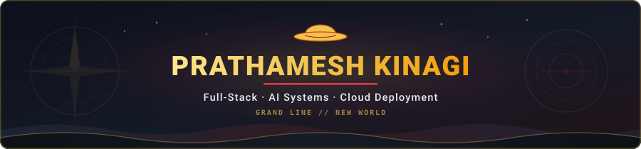
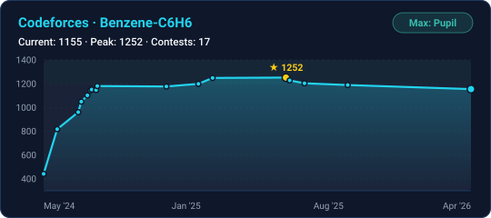
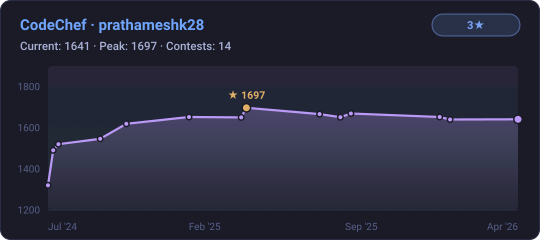

  

  

  
  
  
  

  
  

  

### Selected Work

| Project | Stack | What it does |
| :--- | :--- | :--- |
| **[Heimdall](https://github.com/prathameshk421/Heimdall)** | Go, Podman, MCP, FalkorDB, PostgreSQL, AWS | Sandboxed AI agent harness and autonomous PR engine; runs untrusted agents in rootless Podman containers with knowledge-graph codebase memory. |
| **[Tokenhound](https://github.com/prathameshk421/LLM_Cost_Investigator)** | Python, FastAPI, DuckDB, OpenTelemetry, Langfuse, Kafka | Real-time LLM cost observability and anomaly detection; flags spend spikes in 1–4 min (99.1% recall, 0.5% false alarms on synthetic benchmarks). |
| **[Lexsi Hackathon Project](https://github.com/prathameshk421/lexsi_hackathon)** | Python, PyTorch, Hugging Face, LoRA (SFT + GRPO) | Post-trained a 3.35B open-weights LLM for low-cost multi-turn SQL tool-calling; raised held-out task success from 8% to 50% and halved latency. |
| **[Amazon ML Challenge 2026](https://github.com/prathameshk421/amazon-ml-challenge-2026-entity-resolution)** | Python, LightGBM, PyTorch, LoRA, Sentence Embeddings | 3-stage multilingual business entity matching across 1.7M × 10M records (**0.984 F₀.₅**, Rank 677 / ~24,000 teams). |
| **[Early Signal](https://github.com/prathameshk421/delinquency-ews)** | Python, LightGBM, PyTorch GRU, SHAP, FastAPI, React | Loan default early-warning ensemble (**0.941 AUC**, 89.5% recall) that flags 78% of defaults a median of 3 weeks early with calibrated risk tiers. |
| **[Unified Org Workspace](https://github.com/prathameshk421/unified-org-workspace)** | Next.js, TypeScript, Express, PostgreSQL, Terraform, GCP | Multi-tenant ticketing and review platform with RBAC, session-scoped tenant isolation, append-only audit logs, and Playwright E2E CI. |
| **[grace](https://github.com/prathameshk421/grace)** | Rust, Shell, Homebrew | Fast CLI for jumping between project folders with tags for the AI tools used in each workspace. |

---

### Experience

- **Backend Developer — Pulzion '26 Online Exam Platform:** Built the Node.js, TypeScript, PostgreSQL, and Redis backend on AWS (ECS, RDS, ElastiCache); cut batch scoring **40x** (21s → 0.5s for 3,000 tests) and served **125 concurrent users** on one 0.5-vCPU container with zero errors.
- **AI/ML Contributor — [UPI Payment Verification](https://github.com/PICT-ACM-Student-Chapter/Payment-Verification-OCR-2025/tree/feature-react-fastapi-migration):** Trained a YOLOv12 + OpenCV + Tesseract OCR pipeline (**93.7% accuracy**) shipped in a React and FastAPI app with duplicate checks and CSV export.

---

### Achievements

- **Lexsi AI Safety & Alignment Hackathon:** Top 10% (Top 35 / ~400 teams) for post-training a 3.35B LLM with LoRA (SFT + GRPO) for multi-turn SQL tool-calling.
- **Amazon ML Challenge 2026:** Rank 677 / ~24,000 teams (Top 3%) with **0.984 F₀.₅** on 1.7M × 10M multilingual entity resolution.
- **Kaggle ML Competition (PASC):** 2nd place.
- **Social Winter of Code:** Rank 278 with 4 merged pull requests.
- **Competitive Programming:** Codeforces Pupil (Max 1252) · CodeChef 3★ (Max 1697).

  

### Tech Stack

**Languages & Frameworks**

  

**Databases, Cloud & DevOps**

  

**AI, ML & Observability**

  
  
  
  
  
  
  
  
  
  
  
  
  
  
  
  
  

  

### Competitive Programming

  
  

  

### GitHub Analytics

  

  
  

  

  

  

  <picture>
    <source media="(prefers-color-scheme: dark)" srcset="https://raw.githubusercontent.com/prathameshk421/prathameshk421/output/github-contribution-grid-snake-dark.svg"/>
    <source media="(prefers-color-scheme: light)" srcset="https://raw.githubusercontent.com/prathameshk421/prathameshk421/output/github-contribution-grid-snake.svg"/>
    
  </picture>

  

